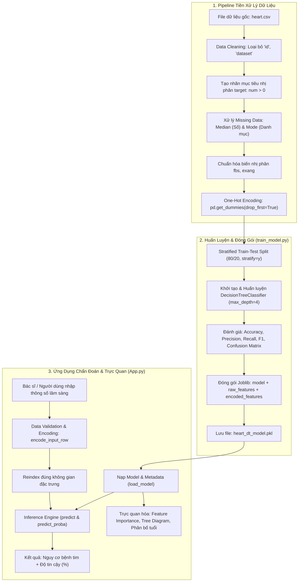

# 🫀 Heart Disease Clinical Prediction & Decision Support System
### *Hệ Thống Phân Tích Dữ Liệu & Hỗ Trợ Chẩn Đoán Nguy Cơ Bệnh Tim Sử Dụng Cây Quyết Định (Decision Tree)*

## 📌 Giới Thiệu Dự Án 

Dự án **Heart Disease Clinical Prediction & Decision Support System** là giải pháp Machine Learning toàn diện (End-to-End ML Pipeline) hỗ trợ đội ngũ y tế, bác sĩ và nhà nghiên cứu sàng lọc sớm nguy cơ mắc bệnh tim mạch dựa trên các chỉ số sinh học và lâm sàng.

Bằng cách ứng dụng thuật toán **Cây quyết định (Decision Tree Classifier)** kết hợp các nguyên lý **Explainable AI (Trí tuệ nhân tạo có thể giải thích được - XAI)**, dự án không chỉ cung cấp kết quả chẩn đoán với độ tin cậy định lượng (Confidence Score) mà còn minh bạch hóa toàn bộ chuỗi quy tắc suy luận (*If-Then Rules*). Điều này giải quyết bài toán cốt lõi trong y tế: **bác sĩ cần hiểu rõ nguyên nhân lâm sàng dẫn đến chẩn đoán trước khi ra quyết định điều trị.**

Dự án được phân tách kiến trúc chuyên nghiệp thành:
1. **Pipeline Tiền xử lý & Huấn luyện mô hình tự động** (`DecisionTree_Heart_Disease_Prediction_train_model.py`).
2. **Ứng dụng CLI Chẩn đoán & Trực quan hóa dữ liệu y khoa tương tác** (`DecisionTree_Heart_Disease_Prediction_App.py`).

---

## 🎯 Kỹ năng học được qua việc phát triển dự án

### 1. Machine Learning & Data Engineering
* **Xử lý dữ liệu y tế thực tế (Real-world Data Wrangling):**
  * Làm sạch dữ liệu, loại bỏ nhiễu và các trường định danh (`id`, `dataset`) không mang giá trị suy luận.
  * Xử lý khuyết thiếu (Missing Data Imputation) khoa học: Dùng **Median** cho các biến số liên tục (`age`, `trestbps`, `chol`, `thalch`, `oldpeak`, `ca`) để hạn chế sai lệch do giá trị ngoại lai (outliers); dùng **Mode** cho các biến danh mục (`sex`, `cp`, `restecg`, `slope`, `thal`).
  * Chuẩn hóa biến nhị phân (`fbs`, `exang`) với cơ chế ép kiểu an toàn (`coerce` handling) chống crash dữ liệu.
* **Feature Engineering & One-Hot Encoding:**
  * Mã hóa biến phân loại với `pd.get_dummies(..., drop_first=True)` nhằm triệt tiêu hiện tượng đa cộng tuyến (Dummy Variable Trap).
  * **Giải quyết bài toán Feature Mismatch khi Inference:** Đóng gói metadata đặc trưng (`feature_names_raw`, `feature_names_encoded`) cùng mô hình, sử dụng kỹ thuật `reindex(columns=..., fill_value=0)` đảm bảo vector đầu vào của bệnh nhân mới luôn tương thích tuyệt đối với không gian đặc trưng đã học.
* **Chiến Lược Huấn Luyện & Đánh Giá Đa Chiều (Evaluation Strategy):**
  * Áp dụng **Stratified Split** (`stratify=y`) bảo toàn tỷ lệ phân bố giữa hai lớp bệnh và không bệnh, loại bỏ rủi ro lệch mẫu (data skewness).
  * Kiểm soát Overfitting bằng kỹ thuật tiền tỉa nhánh (**Pre-pruning** với `max_depth=4`), cân bằng tối ưu giữa Bias và Variance.
  * Tập trung vào chỉ số y khoa sống còn: Đạt **Recall 83%** và **F1-Score 0.82** trên nhóm có bệnh tim (Class 1), giảm thiểu tối đa hiện tượng **Âm tính giả (False Negatives)** – rủi ro bỏ sót bệnh nhân nguy kịch.

### 2. Tư Duy Kiến Trúc & Clean Code
* **Phân tách trách nhiệm (Separation of Concerns - SoC):** Tách bạch rõ luồng Training/Serialization và luồng Inference/Visualization.
* **Model Serialization & Quản lý vòng đời mô hình:** Đóng gói trọn vẹn Model Package dạng Binary Object (`.pkl`) bằng `joblib` phục vụ triển khai production.
* **Lập trình phòng thủ (Defensive Programming):** Bắt lỗi nhập liệu chặt chẽ (`try-except`), kiểm tra sự tồn tại của file dữ liệu/mô hình (`os.path.exists`), thông báo lỗi tiếng Việt thân thiện, không bao giờ để crash ứng dụng ngoài ý muốn.
* **Explainable AI (XAI) & Trực quan hóa dữ liệu:**
  * Trích xuất trọng số thuộc tính quan trọng (`feature_importances_`) dựa trên độ giảm bất thuần khiết Gini (Gini Impurity Reduction).
  * Trực quan hóa cấu trúc cây quyết định qua biểu đồ cây (`plot_tree`), bản địa hóa toàn bộ thuật ngữ y khoa sang tiếng Việt chuyên ngành.

---

## 🛠️ Công Nghệ & Thư Viện Sử Dụng 

| Lĩnh Vực / Công Cụ | Thư Viện / Công Nghệ | Vai Trò & Ứng Dụng Trong Dự Án |
| :--- | :--- | :--- |
| **Ngôn ngữ lập trình** | `Python 3.10+` | Toàn bộ logic xử lý dữ liệu, giải thuật ML và giao diện dòng lệnh tương tác. |
| **Khoa học Dữ liệu** | `Pandas` | Đọc dữ liệu, làm sạch, fill missing values, thao tác DataFrame, One-Hot Encoding. |
| **Tính toán số học** | `NumPy` | Xử lý ma trận, vector đặc trưng, tính toán mảng và sắp xếp chỉ số importance. |
| **Machine Learning** | `Scikit-learn` | Mô hình `DecisionTreeClassifier`, chia tập `train_test_split`, tính ma trận nhầm lẫn `confusion_matrix`, `classification_report`, trực quan cây `plot_tree`. |
| **Trực quan hóa** | `Matplotlib` | Vẽ biểu đồ cột phân bố bệnh, biểu đồ Feature Importance nằm ngang, biểu đồ tần suất theo nhóm tuổi, sơ đồ cây quyết định. |
| **Đóng gói mô hình** | `Joblib` | Lưu trữ và nạp mô hình máy học cùng bộ từ điển đặc trưng (`.pkl`) với hiệu suất nén cao. |

---

## 🏗️ Kiến Trúc Hệ Thống & Luồng Hoạt Động (Architecture & Pipeline)



---

## 📊 Mô Tả Tập Dữ Liệu Lâm Sàng 

Bộ dữ liệu gồm 13 đặc trưng lâm sàng đại diện cho thông tin sinh lý và kết quả xét nghiệm tim mạch:

| Tên Thuộc Tính | Thuật Ngữ Y Khoa | Kiểu Dữ Liệu | Diễn Giải & Giá Trị Ý Nghĩa |
| :--- | :--- | :---: | :--- |
| `age` | Tuổi bệnh nhân | Số (Continuous) | Tuổi tính theo năm (ảnh hưởng lũy tiến tới nguy cơ xơ vữa mạch). |
| `sex` | Giới tính | Phân loại | `Male` (Nam) / `Female` (Nữ) - Nam giới có nguy cơ phát bệnh sớm hơn. |
| `cp` | Dạng đau ngực (Chest Pain) | Phân loại | 4 loại: *typical angina, atypical angina, non-anginal, asymptomatic*. |
| `trestbps` | Huyết áp lúc nghỉ | Số (mmHg) | Huyết áp tâm thu lúc nghỉ ngơi. |
| `chol` | Cholesterol huyết thanh | Số (mg/dl) | Nồng độ mỡ trong máu, chỉ số hàng đầu gây hẹp động mạch vành. |
| `fbs` | Đường huyết lúc đói | Nhị phân (0/1) | $1$ nếu $> 120$ mg/dl (nguy cơ đái tháo đường), $0$ nếu $\le 120$ mg/dl. |
| `restecg` | Điện tâm đồ lúc nghỉ | Phân loại | *normal, st-t abnormality, lv hypertrophy* (phì đại thất trái). |
| `thalch` | Nhịp tim tối đa | Số (bpm) | Nhịp tim tối đa đo được trong nghiệm pháp gắng sức. |
| `exang` | Đau ngực khi gắng sức | Nhị phân (0/1) | $1$ nếu xuất hiện cơn đau khi vận động gắng sức, ngược lại là $0$. |
| `oldpeak` | Độ chênh đoạn ST | Số (Float) | Độ chênh giảm đoạn ST trên điện tâm đồ khi gắng sức so với lúc nghỉ. |
| `slope` | Độ dốc đoạn ST | Phân loại | Hướng của đoạn ST khi vận động: *upsloping, flat, downsloping*. |
| `ca` | Số mạch máu lớn hẹp | Số (0 - 3) | Số lượng nhánh mạch vành chính bị tắc nghẽn nhìn thấy qua xạ hình. |
| `thal` | Thallium Scintigraphy | Phân loại | Kết quả xạ hình tưới máu: *normal, fixed defect, reversable defect*. |
| **`target`** | **Chẩn đoán (Mục tiêu)** | **Nhị phân (0/1)** | **$0$: Không có bệnh tim / $1$: Có bệnh / Nguy cơ cao**. |

---

## 📈 Kết Quả Thực Nghiệm & Đánh Giá Mô Hình 

Mô hình được huấn luyện trên tập kiểm thử độc lập ($20\%$ dữ liệu được phân tầng) với các kết quả định lượng ấn tượng:

### 1. Bảng Chỉ Số Phân Loại Chi Tiết (Classification Metrics)

| Lớp (Class) | Precision (Độ chính xác) | Recall (Độ bao phủ) | F1-Score | Số lượng mẫu (Support) |
| :--- | :---: | :---: | :---: | :---: |
| **0 - Không bệnh** | 0.78 | 0.74 | 0.76 | 82 |
| **1 - Có bệnh tim** | **0.80** | **0.83** | **0.82** | **102** |
| **Độ chính xác tổng thể (Accuracy)** | — | — | **79.00%** | **184** |
| **Macro Average** | 0.79 | 0.79 | 0.79 | 184 |
| **Weighted Average** | 0.79 | 0.79 | 0.79 | 184 |

### 2. Ý Nghĩa Lâm Sàng Của Các Chỉ Số:
* **Recall lớp Có bệnh đạt 83%:** Mô hình phát hiện chính xác hơn $8$ trên $10$ ca thực sự có bệnh, hạn chế tối đa việc để sót người bệnh mà không được điều trị kịp thời.
* **F1-score 0.82:** Thể hiện sự hài hòa giữa khả năng bắt trúng bệnh và độ tin cậy trong các ca dự đoán dương tính.

### 3. Phân Tích Feature Importance (Đặc Trưng Ảnh Hưởng Lớn Nhất):
Qua hàm `plot_feature_importance()`, mô hình chỉ ra các yếu tố quyết định cao nhất đến nguy cơ tim mạch:
1. **Dạng đau ngực không triệu chứng (`cp_asymptomatic`):** Dấu hiệu cảnh báo thiếu máu cơ tim thầm lặng.
2. **Số nhánh mạch vành bị hẹp (`ca`):** Bằng chứng trực tiếp của tắc nghẽn mạch máu.
3. **Độ chênh lệch đoạn ST (`oldpeak`):** Thể hiện sự thiếu hụt oxy của cơ tim khi hoạt động.
4. **Nhịp tim tối đa đạt được (`thalch`):** Thể lực và sức chịu đựng của hệ tim mạch.
5. **Nồng độ Cholesterol (`chol`) & Tuổi (`age`):** Các yếu tố sinh học nền tảng tạo mảng xơ vữa.

---

## 💻 Hướng Dẫn sử Dụng 

### Bước 1: Huấn luyện và đóng gói mô hình
Chạy script huấn luyện để tiền xử lý dữ liệu, kiểm định mô hình và xuất ra file model `.pkl`:
```bash
cd "Source code"
python DecisionTree_Heart_Disease_Prediction_train_model.py
```

### Bước 2: Khởi động Ứng dụng Chẩn đoán tương tác
Chạy chương trình giao diện điều khiển (CLI App) phục vụ người dùng và bác sĩ:
```bash
python DecisionTree_Heart_Disease_Prediction_App.py
```

**Các chức năng trên Menu tương tác:**
* `1`: Nhập thông tin 1 bệnh nhân mới để nhận kết quả phân loại và **Độ tin cậy (%)**.
* `2`: Vẽ biểu đồ cột phân bố bệnh nhân (Không bệnh vs Có bệnh).
* `3`: Trích xuất biểu đồ các thuộc tính quan trọng nhất (Top 10 Feature Importance).
* `4`: Thống kê phân bố số ca mắc bệnh tim theo nhóm tuổi (5 năm/nhóm).
* `5`: Xuất sơ đồ minh họa toàn bộ cây quyết định với quy tắc If-Then tiếng Việt trực quan.
* `0`: Thoát ứng dụng.

---

## ⚖️ Ưu Nhược Điểm & Hướng Phát Triển

### Ưu Điểm Đã Đạt Được:
* **Khả năng giải thích cao (Explainable AI):** Không phải là mô hình hộp đen (Black-box). Từng nhánh rẽ đều có thể giải trình logic y học cho hội đồng chuyên môn.
* **Xử lý phi tuyến tính tự nhiên:** Khám phá tốt các mối liên hệ chéo giữa các chỉ số mà không đòi hỏi biến đổi hàm số học phức tạp.
* **Kháng nhiễu dữ liệu:** Không bị ảnh hưởng bởi việc chưa chuẩn hóa thang đo (Min-Max/Z-score) do thuật toán dựa trên phép chia ngưỡng (threshold-based splitting).

### Hạn Chế Cần Cải Thiện:
* Cây đơn lẻ có tính nhạy cảm với sự dao động nhỏ của tập dữ liệu huấn luyện (High Variance).
* Việc chia ngưỡng rời rạc hóa có thể làm giảm bớt độ mượt mà của các chỉ số sinh lý liên tục.